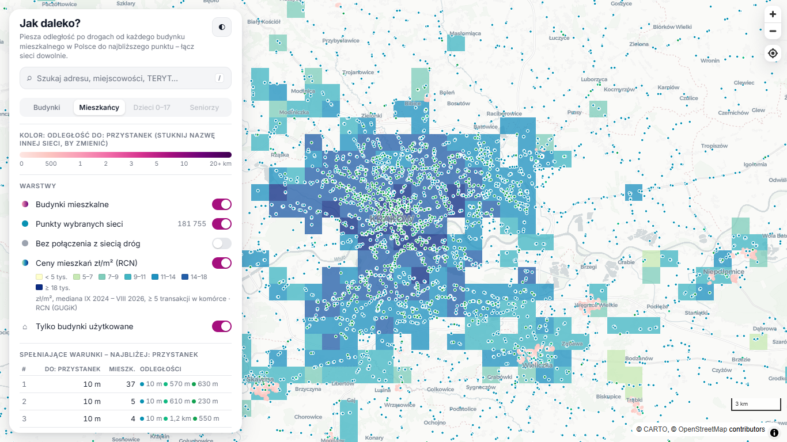
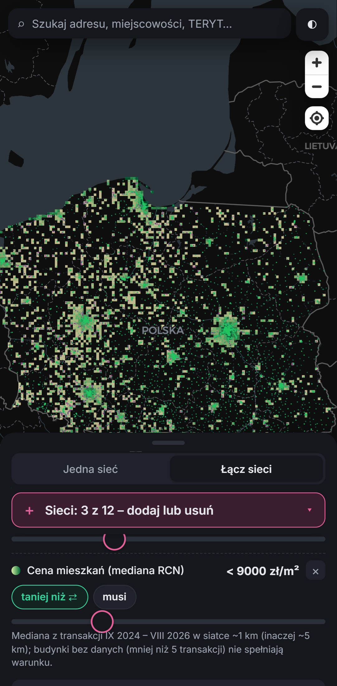

# Jak daleko?

Statyczna mapa pokazuje **pieszą odległość po drogach** od każdego budynku mieszkalnego w Polsce (~8 mln budynków BDOT10k) do najbliższego punktu każdej z 63 sieci. Do mapy dołączony jest **szacunek liczby mieszkańców** (GUS NSP 2021) oraz warstwa **cen mieszkań** (mediana zł/m² z Rejestru Cen Nieruchomości GUGiK).

👉 **https://xoogklastry.github.io/jakdaleko/**

 

## Co można zrobić
- **Jedna sieć albo dowolne łączenie sieci:**
  - wybierasz dowolne sieci, maksymalnie 12 naraz (przy próbie dodania kolejnej pojawia się komunikat);
  - każda sieć ma własny suwak i własny kierunek: **daleko** (dalej niż próg) albo **blisko** (bliżej niż próg), np. „blisko przystanku kolejowego, ale daleko od paczkomatu”;
  - każdy warunek jest **„musi”** albo **„lub”**: budynek musi spełnić wszystkie warunki „musi” i co najmniej jeden z „lub”. Przyciski „Wszystkie warunki” / „Którykolwiek” przełączają wszystko naraz;
  - kolor mapy pokazuje odległość do pierwszej sieci na liście (stuknięcie nazwy innej sieci zmienia to);
  - mapa, liczba budynków i mieszkańców oraz ranking przeliczają się dla całej Polski.
  - Przy pierwszym wyborze kombinacji przeglądarka pobiera kody odległości wybranych sieci (pasek postępu). Potem przeliczenie trwa milisekundy (10 sieci: ok. 0,15 s).
- **Wybór sieci:** 63 sieci w 7 kategoriach (Paczki, Zdrowie, Edukacja, Bezpieczeństwo i urzędy, Kultura/sport/rekreacja, Sklepy i usługi, Transport). Na komputerze nad listą jest pole wyszukiwania i zakładki kategorii.
- **Ceny mieszkań (RCN):**
  - warstwa „Ceny mieszkań zł/m²”: mediana w siatce ~1 km (przy oddaleniu ~5 km), komórki z mniej niż 5 transakcjami są ukryte;
  - warunek **„Cena mieszkań taniej niż / drożej niż X zł/m²”** można dodać do każdej sieci lub kombinacji (zawsze „musi”; budynki bez danych go nie spełniają);
  - w raporcie o budynku: mediana dla okolicy, liczba transakcji, okres i poziom siatki.
- **Telefon:** przycisk „Sieć: … ▾” / „Sieci: … – dodaj lub usuń” zawsze na górze arkusza otwiera pełnoekranową listę z wyszukiwaniem i zakładkami kategorii. Arkusz przewija się palcem, a uchwyt można przeciągnąć albo stuknąć. Motyw jasny lub ciemny jest zgodny z ustawieniem telefonu (przycisk ◐).
- **Gotowe zestawy:**
  - *Wykluczenie usługowe*: szkoła ≥ 3 km, POZ ≥ 5 km i przystanek ≥ 1 km jednocześnie;
  - *Rodzina z dziećmi*;
  - *Senior*;
  - *Paczka bez auta*;
  - *Luka: Żabka blisko, paczkomatu brak* (automat ≥ 1,5 km, Żabka < 600 m);
  - *Wszystko pod ręką* (przystanek < 500 m, POZ < 1,5 km, apteka < 1 km);
  - *Blisko kolei lub metra*;
  - *Rodzina z maluchem* (żłobek < 1 km, przedszkole < 1 km, plac zabaw < 500 m);
  - *Tanio, a blisko do wszystkiego* (przystanek < 500 m, POZ < 1,5 km, Żabka < 800 m, cena mieszkań < 9 000 zł/m²);
  - *Daleko od szpitala i straży* (szpital ≥ 15 km, straż pożarna ≥ 5 km);
  - *Kultura w zasięgu spaceru* (dom kultury < 1,5 km, biblioteka < 1,5 km, kino < 3 km).
- **Wyszukiwarka** (klawisz `/`). Można szukać:
  - miejscowości (PRNG);
  - ulic (PRG);
  - gmin (po nazwie albo kodzie TERYT);
  - nazw punktów wybranych sieci, np. kodu paczkomatu;
  - adresów z numerem domu, przez geokoder Photon (© OpenStreetMap).

  Wynik przybliża mapę do budynku.
- **Raport o budynku** (kliknięcie budynku albo wybór wyniku wyszukiwania):
  - rodzaj i status budynku, TERYT powiatu, szacowana liczba mieszkańców, mediana cen mieszkań w okolicy;
  - dla **każdej z 63 sieci**: piesza odległość po drogach (ta sama wartość co na mapie) oraz nazwa i rodzaj najbliższego punktu;
  - na mapie proste linie od budynku do najbliższego punktu każdej wybranej sieci, z etykietą odległości. Linie są poglądowe, to nie jest trasa;
  - przycisk druku (osobny układ do druku).
- Pasek wczytywania u góry ekranu i szkielety kart podczas pobierania danych.

## Sieci i źródła (stan 2026-10-17/18)
Zasada:
- Najpierw źródła oficjalne: lokalizatory operatorów, feedy GBFS i rejestry publiczne.
- OpenStreetMap jest używany tylko tam, gdzie oficjalne źródło nie działa. Takie warstwy mają w interfejsie znacznik **OSM**.

| Kategoria | Warstwa | Punktów | Źródło | Rodzaj | Stan |
|---|---|---:|---|---|---|
| Paczki | Paczkomat InPost | 30 464 | InPost – API ShipX | oficjalne | 2026-10-17 |
| Paczki | DPD Pickup (punkty i automaty) | 34 688 | DPD Polska – wyszukiwarka DPD Pickup | oficjalne | 2026-10-17 |
| Paczki | DHL POP i DHL BOX | 24 078 | DHL Parcel – mapa DHL POP / BOX | oficjalne | 2026-10-17 |
| Paczki | ORLEN Paczka | 13 208 | ORLEN Paczka – mapa punktów | oficjalne | 2026-10-17 |
| Paczki | Allegro One Box / One Punkt | 2 698 | OpenStreetMap | **OSM** | 2026-10-17 |
| Paczki | Poczta Polska (placówki, automaty, punkty) | 22 442 | Poczta Polska – plik punktów odbioru | oficjalne | 2026-10-17 |
| Paczki | GLS ParcelShop i automaty | 26 436 | GLS Poland – wyszukiwarka ParcelShop | oficjalne | 2026-10-17 |
| Paczki | Dowolny automat paczkowy | 68 061 | Suma automatów wszystkich sieci | połączone | 2026-10-17 |
| Paczki | Dowolny punkt odbioru paczek | 111 578 | Suma punktów i automatów wszystkich sieci | połączone | 2026-10-17 |
| Zdrowie | Przychodnia POZ (lekarz rodzinny) | 8 067 | RPWDL – komórki POZ, adresy PRG | rejestr publiczny | 2026-10-17 |
| Zdrowie | Apteka lub punkt apteczny | 10 946 | Rejestr Aptek, adresy PRG | rejestr publiczny | 2026-10-16 |
| Zdrowie | Szpital | 1 153 | Rejestr podmiotów publicznych (szpitale) + BDOT10k (budynki szpitalne) | rejestr publiczny | 2026-10-18 |
| Zdrowie | Stomatolog (poradnia lub gabinet) | 10 034 | RPWDL – poradnie stomatologiczne (adresy PRG) + OSM (uzupełnienie) | połączone | 2026-10-18 |
| Zdrowie | Lecznica weterynaryjna | 4 526 | BDOT10k (klinika weterynaryjna) + OSM (uzupełnienie) | połączone | 2026-10-18 |
| Edukacja | Szkoła podstawowa (publiczna) | 11 808 | Rejestr podmiotów publicznych (szkoły publiczne) | rejestr publiczny | 2026-10-17 |
| Edukacja | Przedszkole (publiczne) | 8 267 | Rejestr podmiotów publicznych (przedszkola publiczne) | rejestr publiczny | 2026-10-17 |
| Edukacja | Żłobek lub klub dziecięcy | 5 889 | Rejestr Żłobków i Klubów Dziecięcych (MRPiPS, dane.gov.pl, CC0) | oficjalne | 2026-10-14 |
| Edukacja | Szkoła ponadpodstawowa (liceum, technikum, branżowa) | 5 567 | Rejestr podmiotów publicznych (szkoły ponadpodstawowe) + BDOT10k | rejestr publiczny | 2026-10-18 |
| Edukacja | Uczelnia wyższa | 1 159 | Rejestr podmiotów publicznych (uczelnie) + BDOT10k (budynki szkół wyższych) | rejestr publiczny | 2026-10-18 |
| Bezpieczeństwo i urzędy | Urząd gminy lub miasta | 2 466 | Rejestr podmiotów publicznych | rejestr publiczny | 2026-10-17 |
| Bezpieczeństwo i urzędy | Policja (komenda, komisariat) | 2 195 | Rejestr podmiotów publicznych (jednostki Policji) + BDOT10k | rejestr publiczny | 2026-10-18 |
| Bezpieczeństwo i urzędy | Straż pożarna (PSP i OSP) | 15 428 | BDOT10k (straż pożarna – PSP i OSP) + rejestr podmiotów (komendy PSP) | rejestr publiczny | 2026-10-18 |
| Bezpieczeństwo i urzędy | Defibrylator AED | 14 677 | OpenStreetMap (emergency=defibrillator) | **OSM** | 2026-10-17 |
| Kultura, sport, rekreacja | Biblioteka publiczna | 2 742 | Rejestr podmiotów publicznych | rejestr publiczny | 2026-10-17 |
| Kultura, sport, rekreacja | Plac zabaw | 41 221 | OpenStreetMap | **OSM** | 2026-10-17 |
| Kultura, sport, rekreacja | Park lub skwer | 70 054 | BDOT10k – parki i skwery | rejestr publiczny | 2026-10-17 |
| Kultura, sport, rekreacja | Siłownia / fitness | 2 192 | OpenStreetMap | **OSM** | 2026-10-17 |
| Kultura, sport, rekreacja | Dom kultury lub świetlica | 17 530 | Rejestr podmiotów publicznych (ośrodki kultury) + BDOT10k (dom kultury) | rejestr publiczny | 2026-10-18 |
| Kultura, sport, rekreacja | Kino | 563 | OpenStreetMap (amenity=cinema) | **OSM** | 2026-10-17 |
| Kultura, sport, rekreacja | Teatr, opera lub filharmonia | 348 | Rejestr podmiotów publicznych (teatry, filharmonie, opery) + BDOT10k | rejestr publiczny | 2026-10-18 |
| Kultura, sport, rekreacja | Muzeum | 1 714 | Rejestr podmiotów publicznych (muzea) + BDOT10k (budynki muzealne) | rejestr publiczny | 2026-10-18 |
| Kultura, sport, rekreacja | Miejsce kultu (kościół, cerkiew, synagoga, meczet) | 16 035 | BDOT10k (kościół, cerkiew, synagoga, meczet, inny budynek kultu; bez kaplic) | rejestr publiczny | 2026-10-18 |
| Kultura, sport, rekreacja | Obiekt sportowy (kompleks, hala, stadion) | 35 741 | BDOT10k (kompleksy sportowe – punkty na obwodzie, hale, pływalnie) + OSM (uzupełnienie) | połączone | 2026-10-18 |
| Kultura, sport, rekreacja | Pływalnia / aquapark | 1 198 | BDOT10k (basen kąpielowy) + OSM (uzupełnienie) | połączone | 2026-10-18 |
| Kultura, sport, rekreacja | Cmentarz | 53 361 | BDOT10k – cmentarze (punkty dojścia na obwodzie co 100 m) | rejestr publiczny | 2026-10-18 |
| Sklepy i usługi | Żabka | 13 399 | Żabka – lokalizator sklepów | oficjalne | 2026-10-17 |
| Sklepy i usługi | Biedronka | 3 836 | OpenStreetMap | **OSM** | 2026-10-17 |
| Sklepy i usługi | Lidl | 1 030 | OpenStreetMap | **OSM** | 2026-10-17 |
| Sklepy i usługi | Dino | 3 037 | OpenStreetMap | **OSM** | 2026-10-17 |
| Sklepy i usługi | Netto | 693 | OpenStreetMap | **OSM** | 2026-10-17 |
| Sklepy i usługi | Kaufland | 273 | OpenStreetMap | **OSM** | 2026-10-17 |
| Sklepy i usługi | Stokrotka | 898 | OpenStreetMap | **OSM** | 2026-10-17 |
| Sklepy i usługi | Rossmann | 2 119 | Rossmann – lista drogerii | oficjalne | 2026-10-17 |
| Sklepy i usługi | Hebe | 325 | OpenStreetMap | **OSM** | 2026-10-17 |
| Sklepy i usługi | Pepco | 1 215 | OpenStreetMap | **OSM** | 2026-10-17 |
| Sklepy i usługi | Reserved | 175 | OpenStreetMap | **OSM** | 2026-10-17 |
| Sklepy i usługi | H&M | 168 | OpenStreetMap | **OSM** | 2026-10-17 |
| Sklepy i usługi | Zara | 37 | Zara – wyszukiwarka sklepów | oficjalne | 2026-10-17 |
| Sklepy i usługi | Empik | 329 | OpenStreetMap | **OSM** | 2026-10-17 |
| Sklepy i usługi | Księgarnia (w tym Empik) | 1 583 | OpenStreetMap | **OSM** | 2026-10-17 |
| Sklepy i usługi | Targowisko | 1 425 | OpenStreetMap | **OSM** | 2026-10-17 |
| Sklepy i usługi | Bankomat | 10 554 | OpenStreetMap | **OSM** | 2026-10-17 |
| Sklepy i usługi | Oddział banku | 7 062 | OpenStreetMap (amenity=bank) | **OSM** | 2026-10-17 |
| Sklepy i usługi | Gastronomia (restauracja, bar, kawiarnia) | 45 923 | OpenStreetMap (restauracje, bary, kawiarnie) | **OSM** | 2026-10-17 |
| Sklepy i usługi | Centrum handlowe | 2 098 | BDOT10k (centrum handlowe) + OSM (uzupełnienie) | połączone | 2026-10-18 |
| Sklepy i usługi | Market budowlany | 2 625 | OpenStreetMap (shop=doityourself / hardware) | **OSM** | 2026-10-17 |
| Sklepy i usługi | Piekarnia lub cukiernia | 9 464 | OpenStreetMap (shop=bakery / pastry) | **OSM** | 2026-10-17 |
| Transport | Przystanek autobusowy / tramwajowy | 160 289 | OpenStreetMap | **OSM** | 2026-10-17 |
| Transport | Przystanek kolejowy (stacje i przystanki osobowe) | 3 327 | OpenStreetMap (stacje i przystanki osobowe) | **OSM** | 2026-10-17 |
| Transport | Stacja metra (Warszawa) | 38 | OpenStreetMap | **OSM** | 2026-10-17 |
| Transport | Stacja roweru miejskiego | 4 003 | nextbike i GBFS operatorów (+ OSM tam, gdzie brak feedu) | oficjalne | 2026-10-17 |
| Transport | Stacja paliw | 9 336 | BDOT10k | rejestr publiczny | 2026-10-17 |
| Transport | Stacja ładowania samochodów elektrycznych | 6 435 | Baza stacji ładowania (gisss) | inne | 2026-10-17 |

### Uwagi do źródeł (pełne)
- **Allegro One Box / Punkt:** Allegro blokuje automatyczny dostęp (403), a API wymaga rejestracji aplikacji OAuth. Dlatego warstwa pochodzi z OSM i jest niepełna.
- **Szkoły i przedszkola:**
  - źródło: rejestr podmiotów publicznych (gisss/KPP), tylko placówki publiczne;
  - pełny rejestr RSPO (z niepublicznymi) przez API wymaga wniosku o dostęp.
- **POZ:**
  - źródło: RPWDL, komórki z kodem resortowym cz. VIII = 0010, czynne i niezawieszone;
  - adresy są geokodowane do punktów adresowych PRG (skrypt `fetchers/prefilter_registers.py` + `pipeline/geocode.py`);
  - w popupie widać nazwę podmiotu prowadzącego.
- **Apteki:** Rejestr Aptek, aktywne apteki ogólnodostępne i punkty apteczne, geokodowane do PRG.
- **Biblioteki:** rejestr podmiotów publicznych jest niepełny wobec liczby filii.
- **Przystanki kolejowe:**
  - nie ma otwartego, ogólnopolskiego oficjalnego pliku ze współrzędnymi stacji i przystanków osobowych. Portal Pasażera PLK nie udostępnia pliku współrzędnych, a warstwy regionalne nie obejmują kraju;
  - dlatego warstwa pochodzi z OSM (`railway=station` i `railway=halt`, bez metra).
  - Warstwa zastępuje wcześniejszą warstwę „Kolej”.
- **Metro:** OSM (stacje metra w Warszawie, z deduplikacją po nazwie).
- **Rower miejski:**
  - stałe stacje z oficjalnego feedu **nextbike** (Veturilo, WRM, Metrorower i inne);
  - feedy **GBFS** pozostałych systemów stacyjnych w Polsce (np. MEVO; lista systemów: MobilityData `systems.csv`). Systemy bez stacji (Dott itp.) są pominięte;
  - punkty z OSM (`amenity=bicycle_rental`) są dodane tylko tam, gdzie w promieniu 300 m nie ma stacji z feedu; mają typ „OSM (uzupełnienie)”.
- **Rossmann:** oficjalne API lokalizatora `rossmann.pl/shops/api/shops`. API zwraca maksymalnie 2000 najbliższych sklepów, więc wynik jest sumą zapytań z 5 punktów kraju (bez duplikatów).
- **Zara:** oficjalna wyszukiwarka sklepów `zara.com/pl` (siatka zapytań co 0,5° × 0,35°; tylko sklepy stacjonarne marki Zara).
- **Hebe, H&M, Pepco, Reserved, Empik:** lokalizatory blokują automatyczny dostęp (Hebe i H&M: 403) albo nie mają publicznego endpointu (Pepco, Reserved, Empik). Dane z OSM według marki (`brand`/`name`), z wykluczeniem Zara Home, H&M Home, Empik Foto/School.
- **Księgarnie:** OSM `shop=books` (w tym Empik, jeśli oznaczony jako księgarnia).
- **Siłownie i fitness:** OSM `leisure=fitness_centre` oraz `sports_centre` ze `sport=fitness`.
- **Targowiska:** OSM `amenity=marketplace`.
- **v4 – nowe sieci (2026-10-18).** Budynki BDOT10k danej funkcji (pole „funkcje szczegółowe”, tylko eksploatowane) są łączone w obiekty: budynki bliżej siebie niż 60–250 m (zależnie od sieci) to jeden obiekt, a punktem jest największy budynek. Punkty BDOT10k bez nazwy dostają nazwę najbliższego obiektu OSM tej samej kategorii (do 100–300 m). Wielokąty (cmentarze, kompleksy sportowe) mają punkty dojścia na obwodzie co 100 m, jak parki.
  - **Szpital:** rejestr podmiotów publicznych (podmioty lecznicze – szpitale, geokod do adresu lub ulicy) + budynki szpitalne BDOT10k dalej niż 300 m od szpitala z rejestru.
  - **Stomatolog:** RPWDL (otwarte dane, 2026-10-18) – czynne komórki stomatologiczne podmiotów leczniczych (poradnie stomatologiczne, ortodontyczne, chirurgii stomatologicznej, protetyki, periodontologii), adresy geokodowane do punktów adresowych PRG (tylko trafienia do adresu), jedna placówka na adres; uzupełnione gabinetami z OSM dalej niż 100 m. Indywidualne praktyki lekarzy dentystów nie są w RPWDL odróżnione od praktyk lekarskich, dlatego warstwa jest niepełna w małych miejscowościach.
  - **Weterynarz:** BDOT10k „klinika weterynaryjna” + OSM (`amenity=veterinary`) dalej niż 150 m.
  - **Żłobek lub klub dziecięcy:** oficjalny Rejestr Żłobków i Klubów Dziecięcych MRPiPS (dane.gov.pl, CC0, stan 2026-10-14) z geolokalizacją z rejestru, bez instytucji z zawieszoną działalnością.
  - **Szkoła ponadpodstawowa:** rejestr podmiotów publicznych (szkoły średnie, zespoły szkół z liceum/technikum/szkołą branżową w nazwie) + BDOT10k „szkoła ponadpodstawowa” dalej niż 250 m.
  - **Uczelnia:** rejestr podmiotów publicznych (uczelnie, filie, wydziały zamiejscowe) + budynki szkół wyższych BDOT10k dalej niż 300 m.
  - **Policja:** rejestr podmiotów publicznych (komendy i komisariaty) + budynki BDOT10k „policja”.
  - **Straż pożarna (PSP i OSP):** BDOT10k „straż pożarna” (remizy i strażnice) + komendy PSP z rejestru. **AED:** OSM (`emergency=defibrillator`).
  - **Dom kultury lub świetlica:** rejestr podmiotów publicznych (ośrodki i centra kultury) + BDOT10k „dom kultury” (także świetlice wiejskie).
  - **Teatr, opera lub filharmonia; Muzeum:** rejestr podmiotów publicznych (instytucje kultury) + BDOT10k. **Kino:** OSM (`amenity=cinema`, 563 obiekty – zbliżone do liczby kin w Polsce).
  - **Miejsce kultu:** BDOT10k – kościół, cerkiew, synagoga, meczet, inny budynek kultu religijnego (bez kaplic).
  - **Obiekt sportowy:** BDOT10k – kompleksy sportowo-rekreacyjne (punkty na obwodzie), hale sportowe i pływalnie + OSM (ośrodki sportowe, stadiony, hale) dalej niż 200 m. **Pływalnia / aquapark:** BDOT10k „basen kąpielowy” + OSM.
  - **Cmentarz:** BDOT10k – cmentarze wyznaniowe, komunalne i wojenne (bez cmentarzy dla zwierząt).
  - **Bank, gastronomia, market budowlany, piekarnia/cukiernia:** OSM. **Centrum handlowe:** BDOT10k „centrum handlowe” + OSM (`shop=mall`) dalej niż 300 m.
  - **Pominięte:** PSZOK (OSM ok. 900 punktów wobec ok. 2,5 tys. w gminach, brak ogólnopolskiego rejestru), parkingi (brak kompletnego źródła, piesza odległość do parkingu mało przydatna), pogotowie ratunkowe (BDOT10k 339 budynków, rejestr – tylko stacje, nie miejsca stacjonowania zespołów), boiska (tylko OSM, a format strony mieści 64 sieci).
- **Ładowarki EV:** gisss `bazamocy.stacje_ladowania`; pochodzenie niepotwierdzone. Oficjalna EIPA wymaga rejestracji.

## Ceny mieszkań
- Źródło: **Rejestr Cen Nieruchomości** (GUGiK), krajowy plik transakcji lokalami `0_transakcje_ceny_lokale.parquet` z `opendata.geoportal.gov.pl` (otwarte dane od 13.02.2026; pobranie 2026-10-18).
- Wybór: lokale mieszkalne (nieruchomość lokalowa), wolny rynek, akt dotyczący jednego lokalu, data aktu 2024-09-01 – 2026-08-31, powierzchnia 12–300 m², cena 1 500–80 000 zł/m², z geometrią: **396 007 transakcji** (z 560 251 wierszy w okresie; rynek pierwotny 41%). Mediana krajowa: 8 968 zł/m².
- Mediana ceny za m² w siatce ~1 km (0,015° × 0,009°) i ~5 km (0,075° × 0,045°). Komórki z mniej niż 5 transakcjami są ukryte (nie są pokazywane ani używane).
- Wartość budynku: komórka ~1 km, a gdy ma mniej niż 5 transakcji – komórka ~5 km; inaczej brak danych.
- Pokrycie: 7 414 komórek ~1 km i 2 412 komórek ~5 km; dane z 368 powiatów; wartość ma 4 036 111 z 8 047 542 budynków (wszystkie budynki mieszkalne, także na wsi bez transakcji lokalami).
- Ceny pochodzą z aktów notarialnych zgłoszonych przez powiaty; ostatnie miesiące mogą być niepełne, a rynek pierwotny i wtórny są połączone.

## Ludność
- Źródło: ludność ogółem oraz grupy wieku przedprodukcyjnego i poprodukcyjnego z **obwodów spisowych GUS NSP 2021**.
- Rozkład na budynki mieszkalne BDOT10k w obrębie obwodu jest proporcjonalny do **powierzchni zabudowy × liczby kondygnacji**.
- Suma przypisana do budynków jest równa sumie GUS (38 034 012 osób).
- Liczby dla pojedynczych budynków są szacunkiem.
- W trybie łączenia sieci mieszkańcy są liczeni z kodu logarytmicznego (1 bajt na budynek). Błąd dla pojedynczego budynku wynosi ±3–4%, a dla sum jest pomijalny.

## Jak policzono odległości
- Graf pieszy z BDOT10k: SKDR bez autostrad i dróg ekspresowych oraz SKRP.
- Budynek jest dociągany do najbliższej krawędzi grafu (do 100 m).
- Dla każdej sieci liczony jest wieloźródłowy Dijkstra.
- Odległość jest zapisana jako kod 1-bajtowy:
  - co 20 m do 2 km;
  - co 100 m do 10 km;
  - co 500 m do 47 km.
- Najbliższy punkt (po drogach) jest zapisany jako *ranga* wśród punktów sieci posortowanych według odległości w linii prostej (4 bity + lista wyjątków, kafle skompresowane gzipem). Przeglądarka odtwarza go dokładnie z listy punktów.

## Struktura danych
| Plik | Zawartość |
|---|---|
| `config.json` | kategorie, sieci, źródła, zestawy, kafle, statystyki |
| `hist.json`, `stats.json` | liczniki skumulowane dla każdej sieci, liczby nagłówkowe |
| `p/<t>.bin` | pozycje budynków (kafle 0,5°) i flaga użytkowania |
| `a/<t>.bin` | atrybuty: fid BUBD, TERYT, mieszkańcy, dojście, rodzaj, status |
| `w/<t>.bin` | 1 bajt na budynek: użytkowany + log-kod mieszkańców (liczenie kombinacji) |
| `d/<sieć>/<t>.bin` | kody odległości |
| `r/<sieć>/<t>.gz` | rangi najbliższych punktów (gzip; raport pobiera cały kafel i rozpakowuje go w przeglądarce) |
| `pr/<t>.bin` | cena mieszkań dla budynku: u16 = mediana zł/m² ÷ 10 (bity 0–13), poziom siatki (bity 14–15) – do liczenia warunku ceny dla całej Polski |
| `price/g1.bin`, `price/g5.bin` | siatki cen ~1 km i ~5 km: ix, iy, mediana ÷ 10, liczba transakcji (komórki ≥ 5 transakcji) |
| `s/l0.bin`, `s/l1/<t>.bin` | wspólne poziomy uproszczone (jeden reprezentant na komórkę 2 km / 500 m) |
| `n/<sieć>/...` | maksymalny kod odległości w komórce |
| `poi/<sieć>/all.bin`, `t/<t>.bin`, `n/<t>.json`, `names.json` | punkty sieci i ich nazwy (całość albo w kaflach) |
| `q/<xx>.json`, `q/gminy.json` | indeks wyszukiwarki (PRNG, ulice PRG, gminy) |
| `top/<sieć>.json` | najdalej położone budynki |
| `unc.bin` | budynki bez połączenia z siecią dróg |

Kod przetwarzania jest w repozytorium prywatnym `dostepnosc-paczkomaty-zabki`:
- `fetchers/`: `fetch_parcels.py`, `fetch_stores.py`, `fetch_bikes.py`, `osm_extract*.py`, `prefilter_registers.py`;
- `pipeline/`: `networks.py`, `geocode.py`, `popalloc.py`, `export_search.py`, `export_v4.py`, `export_v4_gov.py`, `prep_v4.py`, `prices_v4.py`, `build_site3.py`;
- `web3/`.

## Licencje
- Budynki, drogi, PRG, PRNG i Rejestr Cen Nieruchomości: © GUGiK. NSP 2021: © GUS. RPWDL, Rejestr Aptek i Rejestr Żłobków (CC0): dane.gov.pl / MZ / MRPiPS. Rejestr podmiotów publicznych: gisss (KPP).
- OpenStreetMap: © współtwórcy OpenStreetMap, licencja ODbL. Geokoder Photon: komoot, dane © OpenStreetMap.
- nextbike i feedy GBFS operatorów: dane publiczne operatorów.
- Punkty pozostałych operatorów pochodzą z ich publicznych wyszukiwarek.
- Podkład: © CARTO, © OpenStreetMap.
- Biblioteki: MapLibre GL JS (BSD-3), deck.gl (MIT).
